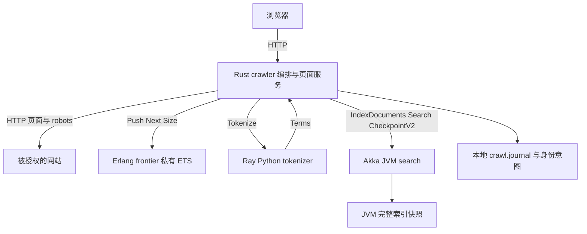
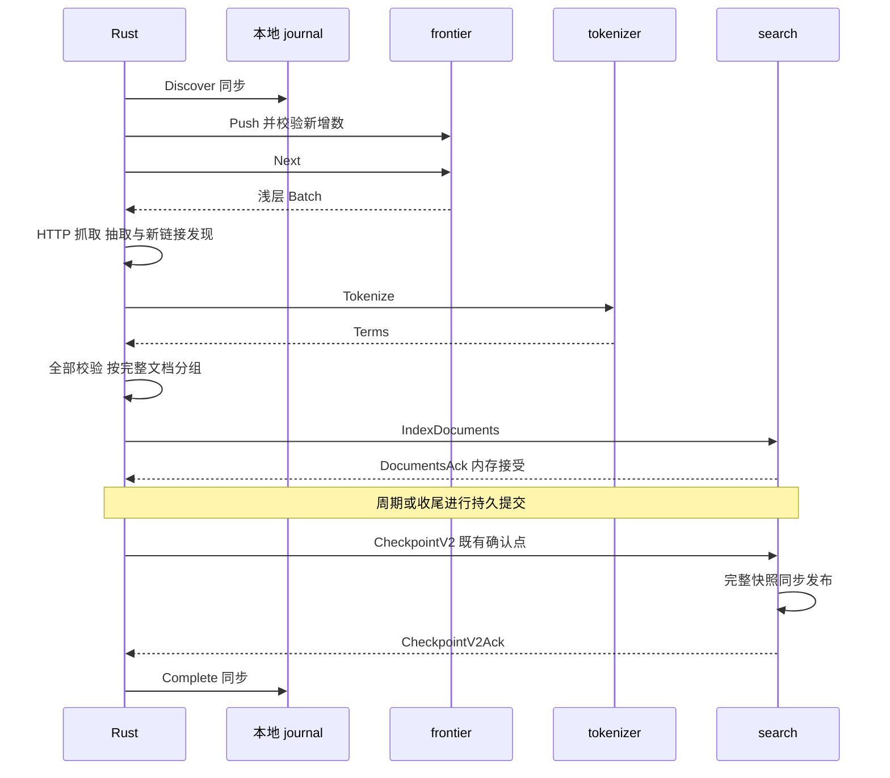

# Websearch 技术架构与实现契约

> 源码对齐日期：2026-11-06。以当前实现为准；示意端口和角色名不是固定部署地址，文中不提供本次未执行的验收结论。

## 1. 项目定位与源码边界

Websearch 是 HTTP(S) 抓取、中文分词、倒排索引、BM25 查询和浏览页面的真实应用，演示 Parrot 在四种运行时中的组网与装配。它不演示框架全部功能，也不是已认证的生产搜索集群。

浏览器使用 Rust 返回的 HTML 和少量 JavaScript，不直接使用 TS Lite。页面不执行目标网站脚本，抽取器不是完整 HTML5 浏览器。

两条业务执行路径共享 [workload.rs](../src/workload.rs)：main.rs 管理外部 direct/registry 网关；application.rs 以标准装配器部署私有网关和真实 crawler Props Actor。两者都保留数据锁到组件与传输退场后。

### 源码导航

- [main.rs](../src/main.rs)：消息注册、网络与制品胶水、安全 Fetcher、HTTP/UI。
- [cli.rs](../src/cli.rs)：参数、输入组合与默认值。
- [application.rs](../src/application.rs)：清单、有效配置、工厂、接线、生命周期。
- [host_runtime.rs](../src/host_runtime.rs)：源码树/安装包运行资源定位。
- [workload.rs](../src/workload.rs)：恢复与抓取主循环。
- [indexing.rs](../src/indexing.rs)：完整文档分组、回复验证和提交。
- [protocol.rs](../src/protocol.rs)、[json_protocol.rs](../src/json_protocol.rs)：有界载荷及 JSON schema。
- [robots.rs](../src/robots.rs)：robots、origin、DNS/地址与重定向约束。
- [crawl_journal.rs](../src/crawl_journal.rs)、[journal_compaction.rs](../src/journal_compaction.rs)：日志与压缩。
- [component_identity.rs](../src/component_identity.rs)、[components.rs](../src/components.rs)：身份与精确退休。
- [index_preparation.rs](../src/index_preparation.rs)、[shutdown.rs](../src/shutdown.rs)：历史准备与关闭。
- [frontier.erl](../erlang/frontier.erl)、[tokenizer.py](../python/tokenizer.py)：调度与分词业务。
- [SearchComponent.scala](../jvm/src/main/scala/websearch/search/SearchComponent.scala)、[SnapshotStore.scala](../jvm/src/main/scala/websearch/search/SnapshotStore.scala)：检索与快照。
- [SearchConfig.scala](../jvm/src/main/scala/websearch/search/SearchConfig.scala)、[SnapshotPreparation.scala](../jvm/src/main/scala/websearch/search/SnapshotPreparation.scala)、[SnapshotReclaimer.scala](../jvm/src/main/scala/websearch/search/SnapshotReclaimer.scala)：配置、后台校验与回收。

## 2. 总体架构



frontier 负责排队与去重，Rust 负责抓取和跨阶段一致性，tokenizer 负责分词与 TF，search 负责持久索引和查询。语言拆分是示例的组件边界选择，不是对这些语言性能优劣或“唯一最佳选型”的证明。

控制面负责握手、部署、停止与清单装配；数据面负责业务请求。部署成功不能代替索引正确性，心跳不能代替业务健康，DocumentsAck 不能代替持久化。

### 拓扑与交付

direct 是应用拨网关；registry 是网关反拨应用；manifest 是本地宿主按清单创建网关与 crawler。Compose 是四容器 registry 形态，真实多机由分发脚本和目标侧入口组装。

启动器的网关端口和 registry 端口由 OS 分配。独立 CLI 默认地址 19871/19873/19872 只用于外部网关配置。Web 实际端口由持有 socket 的应用报告。

网关镜像提供框架与运行时，业务 Beam/Python/JAR 挂载；Rust 二进制 COPY 进入 app 镜像，更新后二进制需要重新构建镜像。原生宿主包是另一种交付，仍要求兼容系统与已安装运行时。

## 3. 各业务角色的实现

### 3.1 Rust 抓取与调度

抓取并发为 8，frontier 预取最多 16 条，文档缓冲达到 8 页后提交分词/索引。主循环以批次派发、等待和处理结果的方式推进；周期检查点约每 60 秒触发，最终收尾另提交一次。不是每个八页批次都强制写完整快照。

`--pages` 是成功和失败合计的尝试硬预算，robots 拒绝也计入，一条重定向链仍为一次尝试。目标提前结束还检查成功站点数量与达到 maxdepth 的站点数量；队列/回填种子耗尽、预算或停止请求也会结束抓取。

入口调度有约 200ms 的 host 间隔，节流任务回队；这不是每 origin 每跳 HTTP 请求的严格限速。Rust 还需完成浅层 pending/在途任务，避免 frontier 预取或节流突破 BFS 层屏障。

没有 origin 限制时可使用内置种子并在队列耗尽后回填；有 `--crawl-origin` 时关闭内置回填。内置种子数量与内容以 workload.rs 的 BUILTIN_SEEDS 为准，不保证公网可达。

### 3.2 HTTP、robots 与 HTML

Fetcher 使用 reqwest，禁用环境代理，对 URL、DNS 结果和每跳重定向执行目标安全检查。公网模式拒绝私网/loopback/link-local/保留地址；显式 IP origin 可授权该协议/IP/端口的受控内网访问，域名仍受 DNS 地址检查。

页面链路总期限 12 秒、重定向最多 5 跳。每跳重新检查 origin、目标地址与 robots。页面正文在传输解码和 gzip 解压后执行 1 MiB 上限，预检 Content-Length 并逐块计数，超限失败而非截断后成功。

robots 以 ParrotWebSearch 产品标识匹配分组，HTTP User-Agent 为 ParrotWebSearch/1.0。按完整 origin 缓存，支持最长匹配、Allow 等长优先、通配与结尾规则及查询/百分号编码语义。

robots 规则解压后最多 500 KiB，必须是有效 UTF-8；下载链总期限 5 秒。缓存默认 256 origin/8 MiB，下载并发 16，同 origin 合并在途下载。成功缓存 24 小时，普通缺失类 4xx 与拒绝/限流及网络失败的处理不同，以 robots.rs 分支为准。

HTML 抽取标题、正文和出链，保留必要块间空白并剔除脚本/样式等；支持 UTF-8 与 GBK 相关内存解码。字符转换、解析和并发另占内存，页面字节预算不是 RSS 上限。轻量解析对复杂网页的支持需要实际语料验证。

文档 ID 是 URL UTF-8 的 SHA256 前八字节转 little-endian u64。批内重定向别名最终 URL 相同取最后一份文档，同 ID 不同 URL 则拒绝；它不是无碰撞的无限空间身份。

### 3.3 Erlang frontier

生产初始化是 parrot_init/1，创建每实例私有的 ordered_set Queue 与 set Seen。队列键为 `{Depth, Sequence}`，单调序号保留同层 FIFO。Next 只取最浅已排队层，不是任意取 N 项。

Push 先完整解码、批内/历史去重并预检容量，再修改两表，拒绝不会污染去重。Queue 默认 65536 项/16 MiB，Seen 默认 262144 项/16 MiB；Next 只释放 Queue 额度，Seen 保留至实例退休。短 URL 复制实际字节，不以小 sub-binary 长期保留整个大帧。

Next 还受协商回复预算约束，只移交装得下的浅层 FIFO 前缀。返回少于请求数不代表队列空；单个队首也放不下会明确拒绝并保留任务。

frontier 在独立 BEAM VM 中执行，不同部署同名模块隔离；实例请求串行，断连不回滚已接受请求，Stop 回收实例和资源。它没有持久队列和消费确认，**Websearch 的恢复依据是 Rust journal**。详见 [Erlang 组件契约](../../../docs/ERLANG_COMPONENTS.md)。

### 3.4 Ray tokenizer

parrot_entry(ctx) 创建实例 dispatcher。Tokenize 处理抽取后的纯文本，通过 jieba.lcut、停用词/短词过滤及 Counter 形成 `(term, doc_id, tf)`。

重复 doc ID 拒绝；回复最多 65536 条且不超过 8 MiB。完整分词、编码与预算验证完成后才更新实例统计。反向文档词集合使重提交删除旧词，零词文档也可清空旧 postings。

这些内存统计可供对账，但不会从 JVM 快照自动重建。keep/serve-only 后 Ray 与 JVM 的 term/posting 数不必相等，不能把“二者永远相等”当健康标准。

Python 与 JVM 使用不同 jieba 实现及不完全相同的停用词表；不能宣称所有切词完全一致。当前业务也没有 Rust jieba-rs 分词阶段。

### 3.5 JVM 索引与搜索

SearchConfig 优先解释 ComponentDeploy.config 的严格 TOML data_dir，再兼容 WS_DATA 和默认 ./data。显式目录要求绝对、无 NUL、最多 4096 UTF-8 字节，配置最多 32768 字节；未知字段、重复键、错误类型/编码/语法拒绝，不回退共享目录。

Actor 恢复 docs、postings，再重建 docLen 和 documentTerms。IndexDocuments 完整解码并校验整个请求后才修改状态：删除该文档旧词，替换元数据，赋值新词频。空词文档同样有效。

IndexTerms 是保留的 upsert：赋值已有 `(term,doc)` 的 TF，不累加，但不删除请求中遗漏的旧词。DocMeta 只改元数据，二者不能替代完整文档原子替换。

Rust 摘要来源截取前 4096 Unicode 字符，JVM 压缩空白后保留最多 280 code points。系统不保存完整网页归档。

查询用 jieba-analysis SEARCH 模式、过滤与去重后计算 BM25：

```text
k1 = 1.2; b = 0.75
idf = ln(1 + (N - df + 0.5) / (df + 0.5))
score(t,d) = idf * tf * (k1 + 1)
             / (tf + k1 * (1 - b + b * dl / max(avgdl, 1)))
```

代码对零长度做保护；按分数降序、同分文档 ID 排序，JSON 分数使用 ROOT Locale 格式化到两位小数。query 运行计数不从磁盘恢复。

### 3.6 Rust HTTP/UI

listener 绑定 `0.0.0.0`；端口 0 由 OS 分配，显式端口占用可向后尝试 20 个偏移，不溢出回绕。绑定在数据修改和远端部署前发生，全部不可用返回启动错误。

首页、/search、/docs、/terms 返回 HTML，/stats 返回 Healthz JSON。搜索 p 从 1 开始、限制 1..10，每页 10 项，最多展示 100 条；docs/terms 的 p 从 0 开始，每页分别 100/300 项。

HTTP 最多同时处理 128 连接，请求有 15 秒总期限。停止关闭监听并排空已开始请求。文本/属性转义、链接方案检查和高亮处理在 Rust 侧执行；错误远端 JSON 应返回 5xx，而非空成功页面。

## 4. 业务协议完整清单

以下全部位于 `bin:ws/` 键空间。Wire 业务整数为 little-endian，`str` 为 `[UTF-8 字节数:u32][bytes]`，`[]` 为空载荷。磁盘快照的端序另见第六节。

```text
Push               n:u32 {url:str depth:u16}*n
PushAck            newly_accepted:u32
Next               wanted:u32
Batch              n:u32 {url:str depth:u16}*n
Size               []
SizeR              queued:u32 seen:u32

Tokenize           n:u32 {doc:u64 text:str}*n
Terms              n:u32 {term:str doc:u64 tf:u32}*n
IndexStats         []
IndexStatsR        terms:u32 postings:u64

IndexDocuments     n:u32 {doc:u64 url:str title:str text:str
                         nterms:u32 {term:str tf:u32}*nterms}*n
DocumentsAck       accepted_documents:u32
IndexTerms         n:u32 {term:str doc:u64 tf:u32}*n
IndexAck           accepted_entries:u32
DocMeta            doc:u64 url:str title:str text:str
DocAck             1:u32

Search             k:u32 query:str
SearchResult       JSON [{doc,score,url,title,snippet}]
Healthz            []
HealthzR           JSON {terms,postings,queries,docs,segments}
ListDocs           offset:u32 limit:u32
ListDocsR          JSON {hosts,total_docs,offset,items:[{host,pages,sample}]}
ListTerms          offset:u32 limit:u32
ListTermsR         JSON {total,offset,items:[{term,df}]}

PrepareIndex       []
PrepareIndexR      ready:u8 verified:u64
CrawlStateV2       [] 或 checkpoint56
CrawlStateV2R      checkpoint56
CheckpointV2       checkpoint56
CheckpointV2Ack    checkpoint56
Clear              []
ClearAck           previous_physical_segment_count:u32
Flush              []
FlushAck           1:u32
```

`checkpoint56 = epoch[16] + generation:u64 + SHA256[32]`。generation 不超过 i64::MAX；PrepareIndexR ready 只能 0/1，verified 不超过 100001。V2 非空请求必须验证历史。

JVM 另保留旧 CrawlState 空请求/24 字节回复、Checkpoint 16 字节 epoch 请求/24 字节回复，当前 Rust 不使用旧接口。旧接口不提供 V2 内容历史证明。

ListDocs/Terms 的 limit 分别限制为 1..200/1..500，unsigned offset 限到实际末页。SearchHit 的 doc 以 i64 表达 u64 ID 位模式；兼容无元数据 posting 时 url/title/snippet 可缺省为空。所有 schema 以 json_protocol.rs 为准。

Rust 原始请求 codec、结构化列表、定宽回复和 JSON 使用不同注册宏。回复必须完整消费；计数、截断、UTF-8、尾部和业务归属均需校验，不是原始 Terms 直接透传 IndexTerms。

## 5. 关键时序与生命周期



独立编排器先在数据锁保护下读取持久 identity/intent，停止上一条记录中的确切旧实例，再同步新意图并 Deploy。组件名包含 identity/role/run，部署回执必须精确等于请求路径。

正常、部分部署失败和业务失败都执行本次部署尝试的精确 Stop。各节点并行退休，只有 COMPONENT_NOT_FOUND 可幂等接受；记录回收错误，最后才关闭远程系统。不是重名错误匹配后的 Drain 重试。

manifest 用 AssemblingContext/LocalDeployer/ProcessGatewayFactory/ThreadPropsSpawner，真实 crawler Props 持有 workflow，通过 wired_ref 使用三条接线。CLI 显式配置覆盖 settings，serve-only 只保留 crawler/search。生命周期排空结束后才关闭接线、组件、网关与引擎。

专用宿主先校验原始清单恰好四组件、唯一 crawler、三个角色、Singleton 主制品和根 hooks，再按 serve-only 裁剪；拒绝 WAN wiring。新增第五组件需要扩展宿主实现，不是仅追加 TOML 即生效。

## 6. 持久化与恢复

Rust 数据根保存 .crawl.lock、crawl.journal、dedupe.tsv、remote.identity、remote.components；JVM 根保存 .search.lock 与 index/seg-*.segment。dedupe.tsv 是兼容投影，不是完成状态权威。

发现意图在 Push 前同步；Complete 在远端持久确认后同步。远端已提交、本地未完成时重放整文档，删除旧词并赋值 TF，允许至少一次执行而不重复累加。

冷启动先发布 Reset 意图，再 Clear 新 epoch，再 Begin；keep 校验 checkpoint 谱系并恢复未完成任务。失败任务留到下一次调用，不是在本次无限重试。serve-only 只查询恢复后的索引。

### JVM v5 完整快照

```text
整数 big-endian，词频 i32 保留 u32 位模式
magic: ASCII PRWSIDX5
epoch: 16 bytes
current generation: i64
ancestor count: u32 (最多 100000)
ancestors: {generation:i64 SHA256:32bytes}，严格递增且小于 current
docs count:i32
docs: {doc:i64 url/标题/摘要各为 [UTF-8长度:u32 bytes]}
terms count:i32
terms: {term:string df:i32 {doc:i64 tf:i32}*df}
CRC32:u32，覆盖此前字节
```

写临时文件、file force、atomic move、directory force 后才确认。Clear 同样先持久发布空快照，再清内存。目录同步失败时新头可能已可见，不能宣称失败无效果；Actor 对存储错误保守停止服务，需修复并重部署。

读取最新完整快照，严格校验长度、重复项、UTF-8、计数、尾部与校验和，最新损坏直接失败，不悄悄回退旧代。兼容读取旧 v1..v4，下次当前存储提交使用 v5；旧读取器不能读取 v5。

v5 保存当前 epoch 历史摘要，拒绝外来 epoch、回退和同 epoch 分叉。旧父链首次迁移需完整验证。PrepareIndex 背景校验，Rust 每 100ms 轮询、总期限 600 秒，单次 RPC 5 秒；serve-only 不触发旧链准备，冷 Clear 不依赖续爬准备。

SnapshotReclaimer 在新头持久后回收旧完整文件，物理数最终收敛到一个；确认时 segments 可暂时大于 1。停止等待准备/回收 worker 后才释放锁。摘要仍有十万条上限，不是无限增长存储。

快照上限 256 MiB、单字符串 16 MiB、文档和词项各 1000000、posting 16000000。完整快照与内存索引另有空间开销，这些限额不是性能容量承诺。

### 本地 journal 原子压缩

格式头 PRWSJ2 换行；记录含 SHA256 前链。Snapshot/RestoreTasks/Seal 保留发现顺序、深度、完成状态和 checkpoint，必须完整 Seal 和校验链才接受。追加尾部不完整可恢复到最后完整记录，完整坏记录不能忽略。

普通追加较上次压缩增长约 4 MiB 或临近 256 MiB 时压缩。单记录 2 MiB、任务 100000，完成任务仍占去重额度；压缩删除重复历史，不丢 pending/seen 以绕过限额。

临时 .crawl.journal.next 同步、rename、父目录同步后发布。失败后不能继续写旧句柄，重开按实际文件恢复。旧无摘要 journal 保守重放全部，旧 dedupe 迁移为深度 0 任务；版本 1 日志可读，旧程序不能读取格式 2。

### 身份与路径

remote.identity 为随机 256 位应用身份；remote.components v2 含最多三个角色、可选 index-data 与 SHA256，最大 32768 字节。意图在 Deploy 前同步，丢失回执仍有确切回收依据。

显式 index-data 在 JVM 解释，持久后 keep/serve-only 不接受变更；旧未绑定应用兼容 WS_DATA。本机启动器默认协调同数据根，原始独立 CLI 的 data 不自动选择 JVM 根；清单宿主首次缺省选择绑定到本机 data。

备份必须成套包含 journal、identity、intent 与对应索引，停止全部写入后再复制。摘要和文件锁不提供分布式 fencing、恶意存储认证、NFS 或任意断电保证。

## 7. 设计决策与实现限制

完整文档替换解决重放重复与删除旧词；完整快照简化恢复，但提交成本随索引增长。Erlang 队列内存化便于调度，Rust journal 承担恢复。分词与检索分离便于异构组件演示，同时引入多运行时依赖与切词差异。

没有生产认证/TLS、任意节点接管、复制共识、自动分片、严格每 origin 限速、网页 JS 渲染或网络 exactly-once 的应用承诺。特定网站当前 403 或网络不可达不是永久架构事实，必须按实际环境诊断。

验证需要分别覆盖主机 direct/registry、清单、部署包、容器、恢复和生命周期。入口与边界见 [tests/README.md](../tests/README.md)；本次文档核对不替代运行这些门禁。
