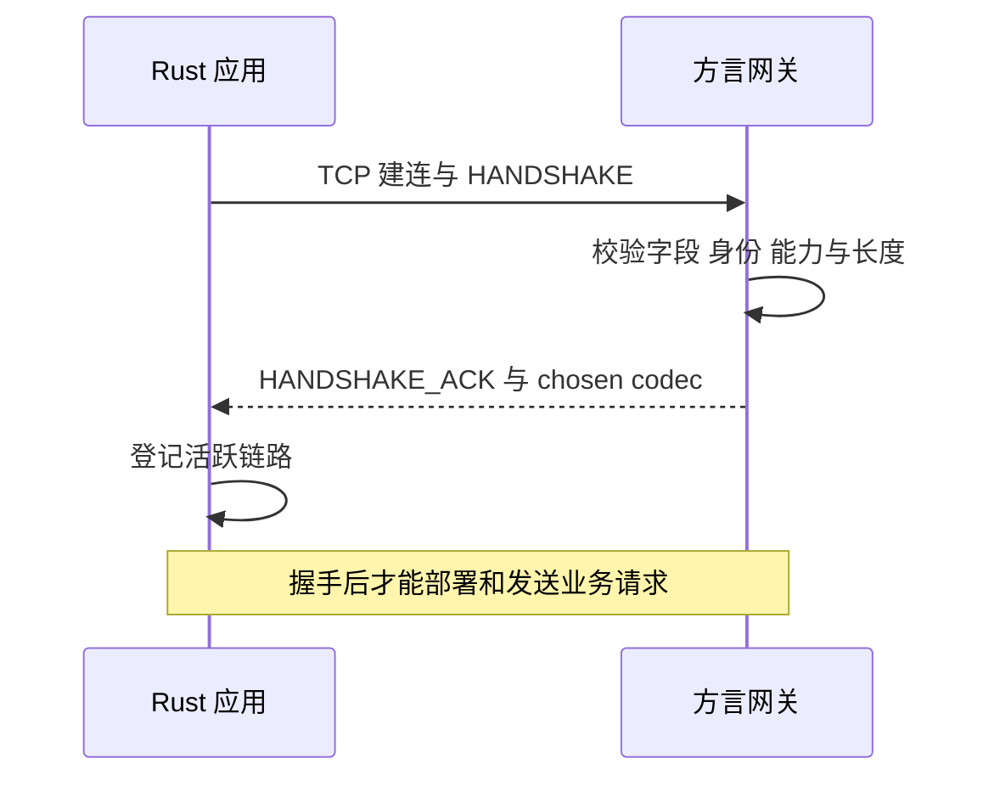
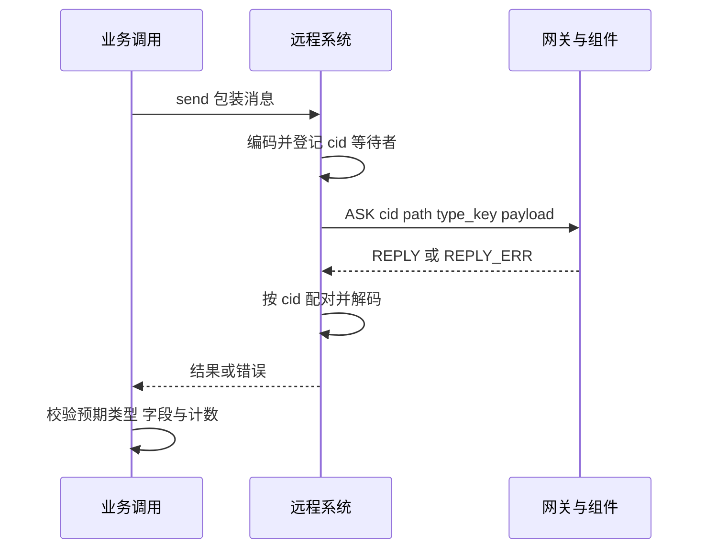

# Websearch 如何使用 Parrot

> 源码对齐日期：2026-11-06。本文只说明实际使用的能力，不将代码检查写成测试通过记录。

## 1. 业务与框架的边界

Websearch 使用 Rust、Erlang/OTP、Ray/Python、Akka/JVM 四种运行时。浏览器只访问 Rust 提供的 HTTP/HTML，不直接使用 TS Lite。

Parrot 提供连接、握手、远程引用、codec 注册、请求/回复、组件部署与停止，以及清单装配。Websearch 实现 URL 调度协议、HTTP 安全规则、分词、完整文档索引、快照与抓取任务恢复。后者不是开启框架开关就能获得的能力。

主要入口是 [main.rs](../src/main.rs)、[application.rs](../src/application.rs)、[workload.rs](../src/workload.rs)。初学者可先阅读[完整教程](../../../documents/README.md)。

## 2. RemoteActorSystem：连接三个网关

独立编排入口用 `RemoteConfig::tcp("websearch", bind_addr)` 创建系统，使用 `NoopLookup`，启动后连接外部网关或等待反拨。应用不通过这个 lookup 暴露本地业务 Actor。

direct 模式调用 `connect(&NodeAddr::tcp(...))`，期望身份分别为 `erl-gw-1`、`ray-gw-1`、`jvm-search-1`。serve-only 只连接 JVM。启动器分配动态端口；原始 CLI 的默认 19871/19873/19872 不是启动器端口约定。

registry 模式由应用监听 `--bind IP:PORT`，网关携 `parrot=应用地址` 主动连接。应用在一个 `--wait` 总期限内等待所需身份的当前活跃、已握手直连；地址表、gossip 条目、hub 路由和无关身份不能充当注册成功。

反拨减少应用对网关地址的配置，但不代表自动重连、故障接管或业务重放已经完成。连接成功以后仍需部署、业务和生命周期检查。未认证远端开发模式需显式选择 `--insecure-development`，它不是生产 TLS/认证配置。

## 3. TLV 握手与能力

实现见 [handshake.rs](../../../crates/parrot-remote/src/handshake.rs)。TLV 为 `[tag:u8][len:u16 LE][bytes]`。

必填字段是 NODE_ID(1)、CAPABILITIES(4)、MAX_FRAME_LEN(5)、TOPOLOGY_ROLE(6)。其它已定义字段包括 REALM(2)、CLUSTER(3)、HOP_LIMIT(7)、DIRECT_ADDR(8)；ACK 还携带 CHOSEN_CODEC(9)。未知 tag 可跳过，已知重复、缺失必填、非法长度或值则拒绝。

本应用关心二进制载荷栈与 ARTIFACTS 管理能力。框架还定义多种可选能力，不能照抄固定能力掩码，声称每个网关都支持 PB、zstd、Wasm 或 Dylib。以实际节点上报和协商结果为准。

帧预算由双方能力与配置约束，默认上限是 16 MiB。协商栈不改变 `bin:ws/*` 的应用定义：这些消息采用手工小端布局或 JSON，不是自动序列化任意 Rust 对象。



握手身份不是密码。组件随机名、节点名和 CRC/SHA 校验都不能替代认证授权。

## 4. CodecRegistry：类型与 type key

Rust 在 main.rs 用四类宏注册消息：

- `wire_msg!`：请求等原始 Vec 包装。
- `wire_list_msg!`：Batch、Terms 解码成有界记录列表。
- `wire_number_msg!`：定宽 ACK、统计、准备进度和检查点。
- `wire_json_msg!`：搜索、健康和浏览 JSON schema。

每个 key 使用独立 Rust 类型。发送端从类型找到编码器，接收端从 key 找到解码器；不同 key 随意复用同一包装类型会使映射含混。

消息集合以源码注册为准，不用过时的“20 个消息”概括。完整清单见[业务协议](ARCHITECTURE.md#4-业务协议完整清单)。

`WsBatch` 和 `WsTerms` 不是无校验透传。`protocol.rs` 用 PayloadReader 限制计数、长度、UTF-8 并检查完整消费；`indexing.rs` 进一步校验 doc ID 归属、词项唯一、词非空和 TF 非零。

JSON 由 `json_protocol.rs` 按 schema 解码：必要字段与类型受校验，未知字段保留前向兼容，不是所有未知 JSON 字段都拒绝。健康统计使用 u64，避免浮点数中转损失精度。

## 5. ASK/REPLY：得到业务结果

实际调用采用 boxed `ActorRef::send`：

```rust
// 当前调用方式的片段；n_bytes 是已编码的 Next 请求。
let reply = frontier.send(Box::new(WsNext(n_bytes))).await
    .map_err(|error| error.to_string())?;
let WsBatch(batch) = expect_reply::<WsBatch>(reply)?;
```

框架编码消息、分配 correlation ID、登记等待者，发送 ASK，再按 ID 关联 REPLY 或 REPLY_ERR。业务继续检查回复类型与语义计数，不应改成 unwrap 后当成可靠错误处理。



帧类型包括 ASK 0x10、REPLY 0x11、REPLY_ERR 0x12、TELL 0x13、HEARTBEAT/ACK 0x03/0x04 和 SYSTEM_EVENT 0x20。应用业务主要使用请求/回复。

必须区分接纳、业务处理和持久化：tell 的接纳不等于处理完成；DocumentsAck 不等于落盘；抓取器收到并验证 CheckpointV2Ack 后才同步本地完成记录。

超时、断连和取消等待不能证明远端未产生副作用。Websearch 用完整文档替换与 journal 重放处理不确定窗口，没有网络 exactly-once 保证。

## 6. admin-v2：部署与停止组件

外部编排器通过 `deploy_component` 发 ComponentDeploy，包含 name、version、artifact、instances 和可选 config。源码使用 Singleton。管理请求走 SYSTEM_EVENT 的 admin-v2 命令/回复子通道，并有独立请求关联。

Beam 指定 app=frontier 与目录 URI；PyModule 指定 module=tokenizer 与目录 URI；Jvm 指定 main_class=websearch.search.SearchComponent 与业务 jar URI。应用用 URL API 编码 file URI，不能直接拼接 `file://` 与 display 路径处理空格、中文、# 或 %。

file URI 指目标网关可见的本地路径，不是上传操作。分发、挂载与宿主打包负责让制品存在。JVM Maven 坐标自动下载不是这个应用的交付路径。

管理类型是跨语言协议，Option、枚举和字段布局不能仅在 Rust 一侧随意改动或省略；修改以实际 admin_v2 编解码与各语言契约测试为依据。

### 6.1 Erlang：私有实例与 BEAM VM

网关验证并复制制品，在独立 BEAM VM 中创建实例，调用 `parrot_init(Context)`。frontier 的 parrot_init/1 创建私有 ETS，parrot_service/4 接收实例状态与回复预算；/3 是便捷适配，/0、/2 只保留显式 legacy 使用。


不同部署的同名模块可在独立 VM 共存。连接断开不清空已接受实例，强制停止会丢弃实例内存。不能描述成 code:purge 网关全局模块后自动迁移状态的热升级。额度、owner、Drain 及回复预算见 [Erlang 契约](../../../docs/ERLANG_COMPONENTS.md)。

### 6.2 Ray：worker 内加载与路径隔离

网关解析 PyModule 和 runtime_env，展开路径、检查冲突与容量，通过 worker 的 mount_module 执行实例加载。业务 parrot_entry(ctx) 返回 dispatcher，handler 和统计状态属于该部署实例。

生产 worker 支持隔离环境与生命周期管理，不能简化为“网关 import 一次，再把同一对象送进所有 actor”。Websearch 未声明 runtime_env，也未使用 JobSubmissionClient 提交整个远端搜索集群。

同名重复部署会要求先 Stop。部署 RPC 失败仍可能留下待退休实例，因此注册表保留不确定路径供明确回收；异常不证明实例一定不存在。

### 6.3 JVM：类加载与真实初始化

网关由 file URI 构造 classloader，加载 ComponentSpi 并创建包装 Actor。search 初始化解析配置、获取 `.search.lock`、恢复快照。初始化成功后才返回部署成功并开放业务路由。

业务 jar 打包 jieba 类、词典、Tomlj 等解析依赖与许可证；Akka、Scala、通用网关和 Java 由宿主提供。它不是零外部依赖的 JVM 程序。

同名替换先退休旧实例，后续新初始化失败不会恢复旧实例，不是无缝原子替换。超时仍存活的退休实例需保留登记，不能直接当成消失。见 [JVM 生命周期](../../../docs/JVM_GATEWAY_LIFECYCLE.md)。

## 7. 组件身份与恢复清理

独立编排器持有 `.crawl.lock` 时读取/创建 remote.identity，生成本次 run ID，构造 `ws-<identity>-<role>-<run>`。

```text
读取旧意图 -> Stop 确切旧地址并确认
  -> 同步新意图 -> 登记本次部署尝试 -> Deploy 并检查精确回执
  -> 运行业务 -> 退休本次尝试部署的全部组件 -> 关闭远程系统
```

这不是“Deploy 重名错误 → Drain → 重试”的旧路径。StopComponent 在启动恢复和退出清理中均使用。只有明确 COMPONENT_NOT_FOUND 可按已不存在处理，其它拒绝或超时要报错。

各节点并行退休，一个失联节点不能阻止其它节点收到 Stop。保留原业务错误和清理错误；回收失败不能输出成功。目录锁保留到组件和传输退场结束。

serve-only 只更新/回收 search，保留其它角色意图。remote.components 版本 2 上限 32768 字节、最多三个角色，兼容版本 1，不是旧文档中的 2048 字节。

## 8. 寻址、心跳与失败

回执路径为 `/user/<实际名称>`。独立入口为 Erlang/Ray 创建对应逻辑引用，JVM 使用 `parrot://jvm-search-1/jvm/user/<实际名称>` 适配网关路径。清单通过 wired_ref 提供引用，不应硬编码随机末段。

心跳默认间隔 2 秒、最大丢失 5 个间隔，可由传输配置调整。心跳检测链路活性，不证明索引内容或磁盘持久化。

断连影响该节点等待者；关键 frontier、tokenizer、索引和最终提交错误会失败退出并清理，不是只打印后无条件继续。HTTP 抓取失败则计入预算并保留恢复任务。

## 9. 清单宿主的实际路径

application.rs 使用 AssemblingContext、LocalDeployer、ProcessGatewayFactory、ThreadPropsSpawner。crawler 是链接进宿主的 `websearch.crawler` Props 工厂，在 thread Actor 中持有 workflow。

deps 描述装配依赖；wiring 把逻辑出口接到真实部署引用。hooks 和停止逻辑控制准入与收尾，持久化完成后才拆接线与私有网关。本地目录锁覆盖整个退出过程。

CLI 显式业务参数覆盖 settings；清单相对路径以清单目录为基准，CLI 数据路径以当前目录为基准。settings 是业务 JSON，config_overlay 是框架配置。

当前专用宿主校验输入恰好四个组件、一个 Parrot crawler、三个匹配角色、Singleton 主制品和指定的根 hooks；它不是可任意追加组件的通用模板。扩展拓扑须同时修改宿主校验、角色解析和 workflow 接线。

serve-only 只装配 search/crawler。索引选择持久绑定，search.data_dir、settings.index_data 和 CLI 声明有冲突检查。runtime-root 是本机完整运行资源树，gateway-process-limit 是拥有的网关/编译器组额度，不是所有后代数量或 RSS 上限。

通用 parrot-app CLI 未链接此业务工厂，不能仅凭清单执行 Websearch；该入口不是 Dylib/Wasm 或跨主机清单发布实现。

## 10. 持久化为何是业务层能力

frontier 出队没有 durable delivery ACK。Rust 在 Push 前同步 Discover，完整文档提交后按周期/收尾发送 CheckpointV2，确认后同步 Complete。重启按 journal 重放 pending，包括失败任务。

JVM 以 epoch、generation 和 SHA256 历史验证恢复来源。index-data 以严格 TOML data_dir 配置传递并持久绑定；旧未绑定应用兼容 WS_DATA。独立目录可并存，但不提供恶意租户权限隔离。

完整文档替换删除旧词并防重放累加 TF；RPC 本身没有这个性质。见[架构恢复](ARCHITECTURE.md#6-持久化与恢复)及[运维恢复](OPERATIONS.md#检索存储与任务恢复)。

## 11. 验证入口与范围

tests/run_all.sh 验证主机真实业务；run_manifest_integration.py 验证清单；run_component_lifecycle.py 等验证真实组件退出；容器有独立 verify_websearch_images.py。

入口存在和 CI 配置存在不等于本次已通过。依赖与范围见 [tests/README.md](../tests/README.md)。本次仅更新文档，不声称重新完成多语言、容器、性能或生产安全验收。
