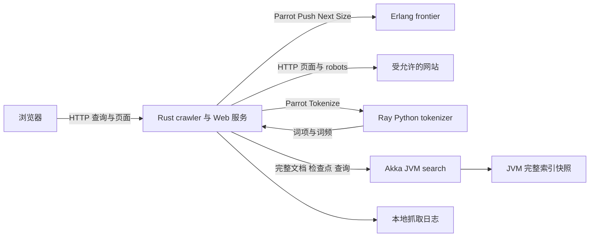

# 03 Websearch 总体架构与源码地图

## 1. 系统目标与边界

Websearch 是一个用于学习真实多语言编排的搜索应用：从 HTTP(S) 网页获得内容，抽取文本，中文分词，建立倒排索引，提供 BM25 搜索和浏览页面。它有实际持久化与崩溃重放机制，但不是完整商业搜索引擎。

它不执行网页 JavaScript，不是分布式浏览器集群；没有因为使用 Actor 就自动拥有多机分片、复制共识或任意节点自动接管。学习价值在于清楚看到语言边界、状态边界和确认边界如何配合。

## 2. 四个业务角色

Erlang frontier 维护私有 ETS 队列与发现集合，以深度和单调序号组织 BFS。它不承担持久化恢复权威，丢失进程后需要 Rust 日志帮助重建。

Rust 是业务协调者，负责安全 HTTP 客户端、文本与链接提取、任务日志、批次提交、组件管理及搜索页面。它不是只转发消息的薄壳。

Python tokenizer 使用 jieba 对页面文本切词，过滤停用词并计算 TF。Ray 提供组件执行宿主。tokenizer 的内存统计不是最终持久化索引。

JVM search 在 Akka Actor 中维护文档、倒排项和检索逻辑，使用 jieba-analysis 对查询切词，并保存可恢复的完整索引快照。最终搜索依据在这里。

浏览器访问 Rust 生成的 HTML 和少量页面 JavaScript。当前这条 UI 链路不要求浏览器直接使用 TypeScript Lite 或直接连接 Parrot Wire。仓库有 TS 协议实现，不代表这个 demo 的浏览器用到了它。

## 3. 为什么拆成这些角色

frontier 把“什么该抓、先抓哪个”与网络 I/O 隔离；tokenizer 把语言处理依赖从抓取器隔离；search 把索引更新和查询状态收拢到单一业务边界。Rust 把这些阶段串起来，同时管理网络安全与持久化顺序。

这种拆分适合教学和异构组件复用。代价是每批处理要跨多条连接，维护多语言依赖，并处理更多中间失败。小规模单机产品完全可以选更少运行时；这里的设计重点是演示 Parrot 的真实编排能力，而不是证明四种语言必然最快。

## 4. 控制面与数据面

控制面处理连接、握手、部署、停止、生命周期和接线。`DeployComponent` 属于管理协议，它告诉网关“加载哪个制品、创建哪个组件”。

数据面处理 `Push`、`Tokenize`、`IndexDocuments` 和 `Search` 等业务消息。一次部署成功并不证明它能正确处理业务；健康检查成功也不证明最终数据已经落盘。

两者都经过 Parrot 网络，但使用不同的契约。测试时应分别验证，不能用管理 ACK 代替一次真正的索引和搜索。

## 5. 三种运行入口

direct：应用主动拨号连接已知网关。`run.sh` 自动创建本机网关并传递实际端口，也可以手工连接远端地址。

registry：应用监听，网关主动反拨注册。`deploy/run-registry.sh` 是本机监督入口；跨机可以使用 `start-remote.sh`。这里的 registry 是运行连接与身份注册入口，不能直接等同于完整的服务发现、认证中心或高可用注册集群。

manifest：Rust 应用内置的宿主读取 `websearch.app.toml`，规划组件，创建网关，部署业务，再把引用注入 workflow Actor。它是声明式应用装配，不是另一套搜索算法。

同一业务逻辑可以在不同入口下运行。测试其中一个入口不能证明另两个入口的启动、接线和回收均正确。

## 6. 关键源码怎么读

- [main.rs](../apps/websearch/src/main.rs)：消息包装、HTTP 客户端、HTML/UI、主入口与跨模块胶水。
- [cli.rs](../apps/websearch/src/cli.rs)：参数解析、输入验证和默认值。
- [application.rs](../apps/websearch/src/application.rs)：清单配置、Props 工厂、接线与 workflow 生命周期。
- [host_runtime.rs](../apps/websearch/src/host_runtime.rs)：宿主运行资源定位。
- [workload.rs](../apps/websearch/src/workload.rs)：真实抓取循环、恢复、发现、完成和提交顺序。
- [indexing.rs](../apps/websearch/src/indexing.rs)：分词、回复验证、完整文档批次编码。
- [protocol.rs](../apps/websearch/src/protocol.rs) 与 [json_protocol.rs](../apps/websearch/src/json_protocol.rs)：有界二进制与 JSON 回复解析。
- [robots.rs](../apps/websearch/src/robots.rs)：robots 解析、缓存与网络访问约束。
- [crawl_journal.rs](../apps/websearch/src/crawl_journal.rs)：任务与检查点日志。
- [component_identity.rs](../apps/websearch/src/component_identity.rs) 与 [components.rs](../apps/websearch/src/components.rs)：持久化身份和精确组件回收。
- [index_preparation.rs](../apps/websearch/src/index_preparation.rs)、[journal_compaction.rs](../apps/websearch/src/journal_compaction.rs)、[shutdown.rs](../apps/websearch/src/shutdown.rs)：准备、压缩与关闭。
- [frontier.erl](../apps/websearch/erlang/frontier.erl)、[tokenizer.py](../apps/websearch/python/tokenizer.py)：两个独立语言业务实现。
- [SearchComponent.scala](../apps/websearch/jvm/src/main/scala/websearch/search/SearchComponent.scala)：索引与搜索 Actor。
- [SnapshotStore.scala](../apps/websearch/jvm/src/main/scala/websearch/search/SnapshotStore.scala)：快照读取、校验和持久化。

建议阅读顺序：CLI → workload 主循环 → indexing → search → journal → application。先理解业务流，再深入框架源码，学习成本更低。

## 7. 不要混淆的几种身份

URL 标识抓取对象，doc ID 标识索引文档，应用 identity 标识数据目录归属，run ID 标识本次运行，node ID 标识网络节点，组件路径标识一次部署实例。

这些身份解决不同问题。仅仅知道“我要连接 search”不足以安全回收旧组件；仅仅看到同一个 URL 也不足以断言远端索引属于同一次冷启动。后续章节会解释为什么应用身份和索引 epoch 都要持久化。
