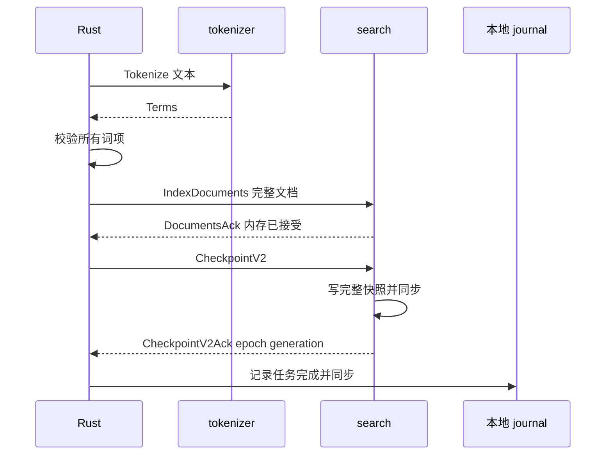

# 04 一次抓取的完整旅程

本章把第一章的一次运行展开成连续步骤。核心阅读入口是 [workload.rs](../apps/websearch/src/workload.rs)、[indexing.rs](../apps/websearch/src/indexing.rs) 与 [SearchComponent.scala](../apps/websearch/jvm/src/main/scala/websearch/search/SearchComponent.scala)。

## 1. 输入校验与启动前检查

CLI 先解析 seed、预算、深度、数据目录与网络模式。未知参数、重复的单值参数、非法数字、非法 URL 等应尽早失败。端口和数据目录也有启动顺序约束，避免一个根本无法提供 Web 服务的任务先破坏已有数据。

不要把“能解析成 URL”当成“允许访问”。URL 还需要满足 HTTP(S)、无凭据、origin 范围和实际网络地址安全规则。

## 2. 发现任务为什么先记日志

入口 URL 和新链接先形成持久化的发现意图，再送到 frontier。理由是：如果先 Push 成功，随后本地崩溃，而 frontier 本身又没有磁盘状态，这个任务可能没有任何恢复依据。

日志承担“有哪些任务尚需处理”的恢复责任；frontier 承担当前运行的高效调度。把恢复与调度拆开，比假设 ETS 永不丢失更明确。

恢复时可以重发任务；frontier 的去重与文档完整替换让重放可控。这是业务层配合协议获得的可靠性，不是 TCP 自动提供的效果。

## 3. frontier 如何实现 BFS

`Push` 携带 URL 和深度。frontier 用私有 ETS 保存已见 URL，队列按 `{depth, sequence}` 排序；sequence 保持同层插入顺序。

`Next(n)` 不简单地任取 n 个任务，而是按当前最浅深度取任务。Rust 协调层还要处理已取出但未结束的同层任务，形成层级屏障：不能因为队列暂时只剩深层任务就越过仍在途的浅层工作。

第一章的循环链接用于观察去重：`actors.html` 指向 `search.html`，反向也成立，但不应无限重复。深度限制是遍历边界，去重是身份边界，两者不能互相替代。

`PushAck` 表示新接受的数量，可能小于提交数，因为其中有重复 URL。索引 `DocumentsAck` 则应等于该批完整文档数。不同 ACK 的计数语义不同，不能统一写成“只要大于零就成功”。

## 4. 尝试预算与站点目标

`--pages` 限制抓取尝试，失败和 robots 拒绝也消耗预算。这样才能限制坏站点导致的无限工作；它不是“成功索引文档数量”。

`--sites` 是成功站点目标，按 host/port 区分。`--maxdepth` 是链接深度限制。三者分别约束工作量、覆盖目标和图遍历范围。

当前主循环的目标提前结束条件还考虑达到最大深度的站点数，因此不是“看到 N 个首页就一定立刻停止”。此外，队列耗尽、预算耗尽和停止请求也会结束抓取。小语料站不必真的达到 sites 才能完成可用的索引。

没有显式 origin 限制时，应用可使用内置公网种子，并在条件满足时回填种子。因此教学实验必须传 `--crawl-origin`，不能只给本机 seed 就认为整个运行一定不会访问公网。

## 5. HTTP 抓取之前的安全检查

普通公网模式拒绝私网、loopback、link-local 和保留地址，并检查 DNS 结果。域名解析结果中出现不允许的地址不能被当成安全公网目标。爬虫禁用环境代理，避免一个不可信 URL 经由环境代理绕开目标检查。

`--crawl-origin` 是严格的 scheme、host、有效端口范围。显式允许 `http://127.0.0.1:18080` 不代表允许 `http://127.0.0.1:18081`，也不代表允许同机所有服务。使用域名 origin 仍需通过相应地址检查。

重定向每一跳都要重新检查目标和 robots，最多允许有限跳数。仅校验初始 URL 会留下“公网地址重定向到内网服务”的漏洞。

这些规则保护抓取目标访问，不构成完整操作系统网络沙箱。若部署环境要求严格出口限制，应结合防火墙、隔离网络和实测。

## 6. robots 为什么也是业务正确性的一部分

抓取器使用 `ParrotWebSearch/1.0` User-Agent，对应产品标识 `ParrotWebSearch`。robots 支持 Allow/Disallow、最长匹配、相同长度 Allow 优先，以及通配与结尾匹配等规则。

robots 有独立的下载大小、时间、并发与缓存上限。当前实现的主要边界包括 500 KiB robots 内容、256 origin、约 8 MiB 缓存和 16 个并发下载额度；成功缓存约 24 小时。部分普通 4xx 可短时允许，401/403/429 等和网络失败有更保守的处理。

不要把 404 robots 与 403 robots 等同处理。前者可能表示网站没有规则文件，后者可能表示明确拒绝访问。精确状态行为以 [robots.rs](../apps/websearch/src/robots.rs) 为准。

页面链路有总期限，robots 也有独立期限，避免大量卡住的请求永久占用抓取资源。现有约 200ms 的调度节奏不应解释为每 origin、每跳严格限速；若业务需要遵守更严格站点配额，需要实现专门调度。

## 7. 限制页面大小为什么不能只看 Content-Length

当前页面预算为 1 MiB，按读取到的解压后内容控制。服务端可能不发送 Content-Length，或者压缩包很小但展开后极大，因此既要预检声明长度，也要流式累计实际字节。

超预算页面应失败，不能悄悄截断后当成完整页面索引。截断可能造成正文、链接或编码边界损坏，并误导用户认为结果完整。

字符集转换和 HTML 解析还会占额外内存，因此“1 MiB 页面预算”不等于“单任务只需 1 MiB 内存”。同理，Wire 大小限制不等于 JVM 索引总内存上限。

## 8. HTML 到文档

Rust 抽取标题、可索引文本和链接，处理相对地址，并进行必要规范化。编码处理覆盖 UTF-8 和部分常见中文编码，GBK 相关转换使用进程内 `encoding_rs`。

这是轻量 HTML 抽取，不是完整浏览器或 HTML5 DOM 引擎。动态渲染正文、复杂错误页面和特殊编码都可能影响抽取质量。tokenizer 收到的是抽取后的文本，不是需要它解析的整页 HTML。

文档 ID 根据 URL 稳定计算。业务提交前还会检查同一 ID 是否对应不同 URL，发现冲突则拒绝，避免静默覆盖另一篇文档。最终重定向 URL 可能让多个输入收敛到同一个文档，批内提交会处理这种重复。

## 9. Python 分词做了什么

`Tokenize` 收到 `(doc_id, text)` 列表，通过 jieba 切词，过滤停用词、空白和长度很短的词，再用 Counter 计算每个词项的词频 TF。

例如正文中某个有效词出现三次，返回一条 `(term, doc_id, 3)`，而不是把三条重复词发送给索引器。这样减少网络数据，也使每文档词项唯一性容易验证。

Python 的分词调用有锁；dispatcher 的统计状态属于本次部署实例。回复完整编码和大小验证完成后才提交统计状态，避免返回一半失败却先改变统计。

当前回复上限为 65,536 条与 8 MiB。重复 doc ID、过大回复和错误载荷应报错。Rust 还会校验词项非空、TF 非零、doc ID 属于本批、同文档词项不重复。Python 成功返回不是省略 Rust 校验的理由。

## 10. 为什么发送完整文档而不是词频增量

当前正常写入路径是 `IndexDocuments`，把文档元数据和完整词集合一起提交。JVM 替换这个 ID 的旧内容：删除旧倒排引用，再安装新文档与词频。

假设第一次文档包含“消息、持久化”，更新后只包含“搜索”。正确结果必须删除旧词。若只做 `tf += delta`，崩溃重试会累计两遍，旧词也无法自然消失。

完整替换还需要处理零词项文档：它可能有标题和 URL，但所有词被过滤。不能因为词项为空就丢掉元数据，也不能遗留旧词。

Rust 按载荷预算拆批，但不把单篇文档拆成语义不完整的多段写入。业务载荷约保留在 15 MiB 内，给 Wire 路由等字段预留空间；单文档超过预算则明确失败。

## 11. 从内存 ACK 到持久化检查点



这个顺序保证本地完成记录不会领先于已确认的远端持久化。崩溃落在最后两步之间时，本地仍可能重放已持久化文档；完整替换使这种至少一次提交不累加词频。

不能把该流程简化为“RPC 成功所以不会丢数据”，也不能把它称为网络 exactly-once。更多恢复边界见第七章。

## 12. 查询与 BM25

浏览器把 `q` 交给 Rust `/search`，Rust 发 `Search(k, query)` 给 JVM。JVM 用 jieba-analysis 切查询词，从倒排表获取候选文档，按 BM25 累计分数。

当前参数为 `k1=1.2`、`b=0.75`。对一个词的主要贡献是：

```text
idf = ln(1 + (N - df + 0.5) / (df + 0.5))
score(term, doc) = idf * tf * (k1 + 1)
                   / (tf + k1 * (1 - b + b * dl / max(avgdl, 1)))
```

N 是文档数，df 是包含该词的文档数，tf 是文档词频，dl 是文档长度，avgdl 是平均长度。代码对空库和长度做边界处理。最终按分数降序、同分按文档 ID 排序，保证稳定性。

词频并非越高越线性加分：分母使贡献趋于饱和。长文档也不会单靠更多字词无条件占优。若要验证算法，必须用独立计算的数值与精确文档集合，不能只断言“结果非空”。

Python jieba 与 JVM jieba-analysis 是不同实现，不能仅因名字相近就保证所有词完全一致。停用词和单字过滤也会影响召回。搜索质量调优要同时观察 `/terms` 与查询分词，而不是盲目修改 BM25 参数。

## 13. Web 展示与边界

Rust 将搜索结果渲染为 HTML，处理文本与属性转义；结果链接还需检查方案。查询高亮不能破坏转义或把网页标题变成可执行脚本。

UI 每页十条，查询页号限制在 1 到 10，最多展示一百条排名结果。`/docs` 按站点聚合，不是所有原始文档的 JSON 导出；`/terms` 展示词项及 df。`/stats` 反映搜索组件状态，不能单独证明爬虫仍健康或所有任务完成。
